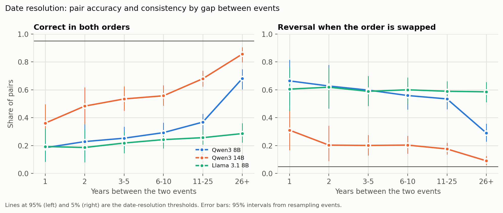
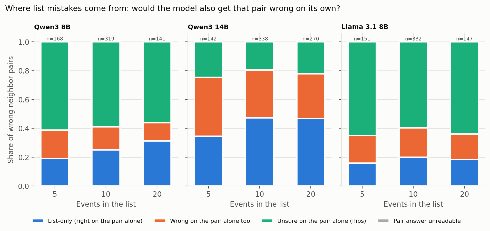
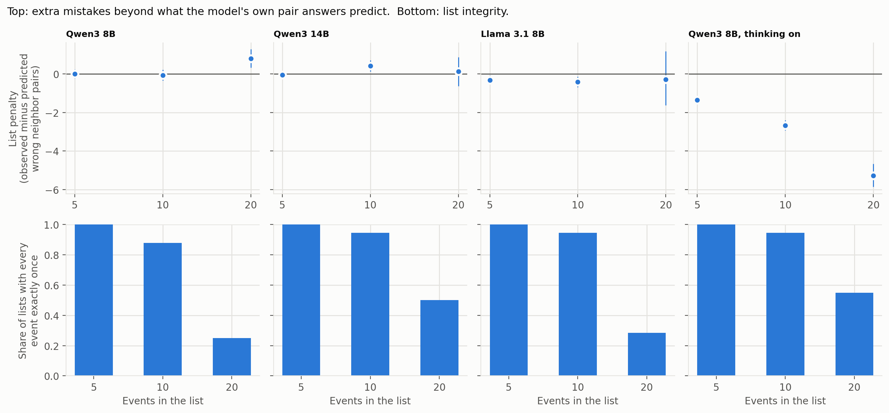

# Pairwise Temporal Judgments and List Ordering in Small Language Models

**Study directed by Jayden Ling. Code, analysis and write-up by Claude Code (an AI agent), checked by Jayden.**

Report dated October 12, 2026. **Status: draft, pending review and approval by Jayden Ling.**

---

## Summary

**Question.** Language models usually identify correctly which of two events occurred first, yet they rarely place a
long list of events in exactly the correct order. Wongchamcharoen and Glasserman (2025) documented this pattern and
left its cause open. This study examines small models that run on consumer hardware and asks two questions. First,
how far apart in time must two events be before a model answers "which came first?" correctly and consistently,
giving the same answer when the order of presentation is reversed? Second, when a model orders a list, are its
errors ones it also makes when asked about the same two events in isolation, or do they arise only within the list?

**Method.** The study used 120 historical events, one per year from 1900 to 2019, dated from Wikipedia and verified
against Wikidata. Three models with reasoning ("thinking") disabled (Qwen3 8B, Qwen3 14B and Llama 3.1 8B) were asked
about all 7,140 pairs of events, each pair twice in opposite orders, and were asked for the year of each event. Each
model also ordered the same 240 lists of 5, 10 or 20 events. Qwen3 8B with thinking enabled ordered the same 240
lists. Every error in a list was traced to the model's own answer on the corresponding pair. The scoring rules and
predictions were fixed in `PREREG.md` before the main data were collected.

**Principal findings.** Ranges are 95% intervals from resampling events or lists; sources are given in section 3.
1. **No model reached a reliable date resolution.** For events more than 25 years apart, the share of pairs answered
   correctly in both orders was 68% for Qwen3 8B (interval 60% to 75%), 86% for Qwen3 14B (80% to 91%) and 29% for
   Llama 3.1 8B (22% to 36%), against the pre-registered threshold of 95%. Most errors were reversals: the answer
   changed when the order of the two events was swapped. The models also favored the first option presented, which
   was chosen in 69% (Qwen3 8B), 54% (Qwen3 14B) and 79% (Llama 3.1 8B) of answers.
2. **Consistent answers form a single timeline.** Among sets of three events for which all three pairs received
   consistent answers, cyclic judgments (A before B, B before C, C before A) were almost absent: 14 cycles against
   about 3,281 expected under random placement of the same errors (Qwen3 8B), 140 against about 12,424 (Qwen3 14B),
   and 30 against about 6,015 (Llama 3.1 8B). The inconsistency lies in order-dependent reversals, not in cycles.
3. **Most list errors are already present at the pair level.** Among adjacent events placed in the wrong order, the
   share that the model had answered correctly in both orders when asked about the pair alone ("list-only" errors)
   was 19% to 31% for Qwen3 8B, 16% to 20% for Llama 3.1 8B and 35% to 47% for Qwen3 14B, depending on list length.
   Under the pre-registered decision rules, Qwen3 8B shows "a real long-list penalty" (0.80 more adjacent errors per
   20-event list than its pair answers predict, interval 0.33 to 1.28). This verdict depends on how replies that
   reached the length limit are scored (section 4); under the alternative reading it is "in between". Qwen3 14B and
   Llama 3.1 8B are classified "in between". Separately, long lists were frequently incomplete: only 25% (Qwen3 8B),
   50% (Qwen3 14B) and 28% (Llama 3.1 8B) of 20-event answers contained every event exactly once.
4. **Reasoning improves list ordering substantially, but not chiefly by removing list-only errors.** With thinking
   enabled, Qwen3 8B ordered 57% of 5-event lists exactly (3% with thinking disabled) and made 5.3 fewer adjacent
   errors per 20-event list than its thinking-disabled pair answers predict (interval 4.7 to 5.9). The prediction
   that reasoning would reduce list-only errors more than other errors (P6) was not supported: the list-only share
   changed little (31% to 24% at 20 events; difference -7 percentage points, interval -16 to +2). With thinking
   enabled, 52% of the remaining adjacent errors at 20 events involved events whose years the model had placed in the
   same wrong order when asked directly, compared with 12% with thinking disabled.

**Interpretation.** For these small models, the failure to order long lists is largely not a new phenomenon that
emerges with length. It mostly reflects the same uncertainty observed on single pairs, chiefly answers that depend
on the order of presentation, together with a separate tendency to omit events from long lists. Reasoning reduces
errors considerably, and the errors that remain are more often attributable to incorrect knowledge of dates. For
practitioners using small models to order events, the results suggest that, without reasoning, the relative order
of events less than about 25 years apart should not be relied upon, and that outputs should be checked for omitted
items.

**Limitations.** Four model setups and 120 events from a single period (1900 to 2019). Llama 3.1 8B was run on
different hardware (a Windows PC) from the Qwen3 models (a Mac). The 20-event results rest on 15 to 33 complete lists
per setup. One verdict depends on a scoring decision made after results were seen; both outcomes are reported. The
event descriptions were written by an AI system. Details are given in section 5.

---

## Full report

### 1. Research questions and predictions

The study addresses two questions (`PREREG.md` section 1):
- **Q1, date resolution:** the smallest gap in years at which a model answers "which came first?" correctly in both
  orders for at least 95% of pairs, with at most 5% reversals, in that gap band and every wider band.
- **Q2, origin of list errors:** the share of a model's list errors that it also makes on the same two events in
  isolation.

Six predictions were registered before the main runs (`PREREG.md` section 2). Their outcomes are summarized in
section 3.5.

### 2. Methods

**Events.** The study used 120 events, one per year from 1900 to 2019. For each year a month was drawn at random with
a recorded seed, and the first event in that month on the year's English Wikipedia page was selected if it occurred
on a single identifiable day, matched a Wikidata date to the day, and had articles in at least 20 language editions
(`PLAN.md` decisions 2 and 3 and section 8). Each event was rewritten as a short description containing no numbers
or ordering words, so that the wording does not reveal the answer. Jayden Ling verified 10 event dates against the
sources (all correct). Files: `data/processed/events.csv`; downloads and licenses are recorded in
`data/raw/SOURCES.md` (Wikipedia text under CC BY-SA 4.0, Wikidata under CC0, retrieved October 12, 2026).

**Questions** (exact wording in `PREREG.md` section 4):
- *Pair:* "Which of these two events happened first? A: ... B: ... Answer with only the letter A or B." Each pair was
  asked in both orders, giving 14,280 questions per model.
- *Year:* "In what year did this event happen? ... Answer with the year only." All 120 events.
- *List:* events were shown with random two-letter codes, and the model answered with a numbered list of codes. There
  were 240 lists of 5, 10 and 20 events, with adjacent events (in true order) 1 to 2, 3 to 5 or 6 to 10 years apart;
  the combination of 20 events and 6 to 10 years was excluded. All models received the same lists
  (`data/processed/main_lists.json`).

**Models** (Ollama 0.40.3, run locally with no data sent to external services; `PREREG.md` section 3 and
Deviations):

| Setup | Model | Hardware | Settings |
|---|---|---|---|
| Qwen3 8B | `qwen3:8b` (ID 500a1f067a9f) | Mac (Apple M5 Pro, 24 GB) | thinking disabled, temperature 0 |
| Qwen3 14B | `qwen3:14b` (ID bdbd181c33f2) | Mac | thinking disabled, temperature 0 |
| Llama 3.1 8B | `llama3.1:8b` (ID 46e0c10c039e) | Windows PC (RTX 3060 Ti, 8 GB) | no thinking mode, temperature 0 |
| Qwen3 8B, thinking enabled | `qwen3:8b` | Mac | lists only; temperature 0.6, top_p 0.95, top_k 20 (the model card's recommended settings) |

Each thinking-disabled model answered 15,170 questions: 120 year questions, 14,280 pair questions, 240 lists, and 530
repeated questions used to confirm that identical questions receive identical answers. Raw replies are stored in
`data/raw/model_runs/main/<setup>.jsonl`.

**Scoring** (`PREREG.md` section 5):
- Each *pair* is classified as **stable-right** (correct in both orders), **stable-wrong** (incorrect in both orders)
  or a **reversal** (the answer changes when the order is swapped; called a "flip" in `PREREG.md`).
- A *list* is **valid** if its first N entries name each event exactly once. In a valid list, each pair of adjacent
  events in the wrong order is an **adjacent error** ("wrong neighbor pair" in `PREREG.md`). A list is exactly correct
  if and only if it contains no adjacent errors, so every list error can be traced to a single pair. Each adjacent
  error is classified from the model's own pair answers as **B** (stable-wrong on the pair alone), **U** (a reversal on
  the pair alone) or **C** (stable-right on the pair alone, a "list-only" error). It is additionally flagged
  **A, misdated** if the model's own year answers place the two events in that wrong order.
- **List penalty:** the number of adjacent errors minus the number expected if the list were ordered using only the
  model's pair answers (each event receives one point for every pair question in which it was named as earlier). A
  positive value means the list is worse than the pair answers predict.
- Lists produced with thinking enabled are classified using the thinking-disabled pair and year answers of the same
  Qwen3 8B model.

**Uncertainty** (`PREREG.md` section 6): intervals for pair results come from 2,000 resamples of the 120 events, and
intervals for list results from 2,000 resamples of lists within each length and spacing group. The latter may be too
narrow because lists share events. Cycle counts are compared with 1,000 random reassignments of each model's
stable-wrong answers within each gap band.

**Code.** `src/analyze.py` (all pre-registered results), `src/p6.py` (prediction P6), `src/make_figures.py` (figures)
and `src/explore_cutoff.py` (an exploratory comparison, section 4). The code was written by Claude Code. The analysis
code was tested on two simulated models with known answers before any main data were examined (`PREREG.md`
Deviations, clarification 4).

**Independent verification.** A separate AI system (Claude Sonnet), given only `PREREG.md`, the event list and the raw
replies, and without access to the analysis code or results, implemented its own scoring and recomputed the pair
shares, first-option rates, cycle counts, valid-list shares and the B/U/C composition of list errors for all four
setups. All values matched those reported below. It did not recompute intervals, the list penalty or the misdated
flag. Its code and output are in `verification/`.

### 3. Results

**Sources for all figures in this section:** `data/processed/results/<setup>.json`; the tables in
`data/processed/results/tables/` (`pairs_by_gap.csv`, `cycles.csv`, `lists_by_length.csv`,
`list_mistakes_by_length.csv`); `data/processed/results/p6_thinking.json`; and
`data/processed/results/explore_cutoff_qwen3-8b-nothink.txt`. All were generated on October 12, 2026 from the raw
replies.

#### 3.1 Pair judgments: no model reached a date resolution (Q1)

Share of pairs answered correctly in both orders, by gap between the two events (95% interval in brackets):

| Gap (years) | Qwen3 8B | Qwen3 14B | Llama 3.1 8B |
|---|---|---|---|
| 1 | 18% [8 to 32] | 36% [23 to 50] | 19% [8 to 32] |
| 2 | 23% [11 to 36] | 48% [35 to 62] | 19% [8 to 31] |
| 3 to 5 | 25% [18 to 34] | 53% [45 to 63] | 22% [15 to 30] |
| 6 to 10 | 29% [23 to 36] | 56% [48 to 63] | 24% [18 to 31] |
| 11 to 25 | 37% [31 to 43] | 68% [62 to 74] | 26% [21 to 32] |
| more than 25 | 68% [60 to 75] | 86% [80 to 91] | 29% [22 to 36] |
| Reversals, more than 25 years | 29% [23 to 36] | 9% [6 to 13] | 59% [51 to 66] |

- **Date resolution was not reached by any model.** No gap band, including "more than 25 years", reached 95% correct
  in both orders with at most 5% reversals.
- **Preference for the first option.** Share of all pair answers that were "A": Qwen3 8B 69%, Qwen3 14B 54%,
  Llama 3.1 8B 79%.
- **Year questions.** Exact years given, out of 120: Qwen3 8B 87, Qwen3 14B 102, Llama 3.1 8B 97.
- All pair replies from all models were readable (0 unreadable out of 14,280 per model).

#### 3.2 Cycles among consistent judgments

Sets of three events for which all three pairs received consistent answers, and the number forming a cycle:

| | Consistent triples | Cycles observed | Cycles expected under random placement of the same errors (95% of reassignments) |
|---|---|---|---|
| Qwen3 8B | 66,393 | 14 | 3,281 (3,012 to 3,602) |
| Qwen3 14B | 188,198 | 140 | 12,424 (11,931 to 12,961) |
| Llama 3.1 8B | 27,761 | 30 | 6,015 (5,829 to 6,199) |

For every model, none of the 1,000 reassignments came as close to the observed count (p < 0.001). Where these models
give consistent answers, those answers are compatible with a single ordering of events, even where that ordering is
incorrect.

#### 3.3 List ordering: the origin of errors (Q2)

| | Length | Valid lists | Adjacent errors | B: wrong on pair | U: reversal on pair | C: list-only [interval] | List penalty per list [interval] |
|---|---|---|---|---|---|---|---|
| Qwen3 8B | 5 | 100% | 168 | 20% | 61% | 19% [14 to 24] | 0.00 [-0.23 to 0.23] |
| | 10 | 88% | 319 | 16% | 59% | 25% [21 to 30] | -0.06 [-0.34 to 0.22] |
| | 20 | 25% | 141 | 13% | 56% | 31% [25 to 38] | +0.80 [0.33 to 1.28] |
| Qwen3 14B | 5 | 100% | 142 | 41% | 25% | 35% [28 to 41] | -0.04 [-0.23 to 0.14] |
| | 10 | 94% | 338 | 33% | 20% | 47% [42 to 52] | +0.42 [0.13 to 0.70] |
| | 20 | 50% | 270 | 31% | 22% | 47% [42 to 52] | +0.13 [-0.64 to 0.86] |
| Llama 3.1 8B | 5 | 100% | 151 | 19% | 65% | 16% [9 to 23] | -0.32 [-0.53 to -0.09] |
| | 10 | 94% | 332 | 20% | 60% | 20% [16 to 24] | -0.42 [-0.69 to -0.15] |
| | 20 | 28% | 147 | 18% | 64% | 18% [14 to 24] | -0.29 [-1.63 to 1.18] |

**Pre-registered verdicts.** Under `PREREG.md` section 6, the verdict is "mostly in the pairs" if list-only errors are
at most 20% at every length and the penalty interval includes zero at every length; "a real long-list penalty" if
list-only errors rise with length to at least 50% at 20 events, or if the penalty interval at 20 events lies above
zero; and "in between" otherwise.
- **Qwen3 8B: a real long-list penalty**, through the penalty at 20 events (+0.80, interval 0.33 to 1.28). The
  list-only share rose (19% to 31%) but remained below 50%. **This verdict depends on a scoring decision** (section 4):
  if the 16 lists that listed every event and then reached the reply length limit are treated as unreadable, the
  verdict is "in between" (penalty +0.50, interval 0.00 to 1.00, based on 6 valid 20-event lists).
- **Qwen3 14B: in between.** List-only errors were common (35% to 47%) and reached 47% at 20 events, just below the 50%
  threshold. The penalty was above zero at 10 events (+0.42) but not at 20 events, the length used by the rule.
- **Llama 3.1 8B: in between.** List-only errors remained below 20% at every length (19.9% at 10 events), but the
  penalty was *below* zero at 5 and 10 events: its lists contained fewer adjacent errors than its pair answers predict.

**Omitted events.** Long lists were often incomplete before any ordering error arose. Share of 20-event answers
listing every event exactly once: Qwen3 8B 25%, Qwen3 14B 50%, Llama 3.1 8B 28% (`lists_by_length.csv`). Every
incomplete 20-event answer omitted at least one event.

#### 3.4 Effect of reasoning (Qwen3 8B, same lists)

| Length | Exactly correct, thinking off / on | Valid, off / on | Adjacent errors per valid list, off / on | List-only share, off / on (difference [interval]) | Wrong-on-pair share, off / on (difference [interval]) |
|---|---|---|---|---|---|
| 5 | 3% / 57% | 100% / 100% | 1.9 / 0.5 | 19% / 18% (-1 [-13 to +12]) | 20% / 31% (+11 [-1 to +25]) |
| 10 | 0% / 26% | 88% / 94% | 4.0 / 1.2 | 25% / 28% (+3 [-6 to +11]) | 16% / 25% (+9 [+0.4 to +18]) |
| 20 | 0% / 0% | 25% / 55% | 9.4 / 3.0 | 31% / 24% (-7 [-16 to +2]) | 13% / 17% (+4 [-3 to +12]) |

Adjacent errors per valid list are computed as the number of adjacent errors divided by the number of valid lists
(`lists_by_length.csv`, `list_mistakes_by_length.csv`). Differences are in percentage points (thinking on minus off),
with intervals from paired resampling of the same lists (`p6_thinking.json`).

- With thinking enabled, lists outperformed the predictions of the thinking-disabled pair answers by 1.4 (5 events),
  2.7 (10 events) and 5.3 (20 events) adjacent errors per list (intervals 1.2 to 1.5, 2.4 to 2.9 and 4.7 to 5.9).
- **P6 was not supported.** Reasoning reduced all categories of error by broadly similar proportions, so the list-only
  share did not fall more than the wrong-on-pair share. At 10 events the wrong-on-pair share increased.
- With thinking enabled, 60%, 49% and 52% of the remaining adjacent errors (5, 10 and 20 events) involved events
  whose years the model had placed in the same wrong order when asked directly, compared with 19%, 16% and 12% with
  thinking disabled.

#### 3.5 Outcomes of the predictions

| Prediction | Outcome |
|---|---|
| P1: for Qwen3 8B, correct-in-both-orders rises with the gap, and reversals are most frequent at 1 to 2 years | **Largely supported.** The share rises in every band (18% to 68%). Reversals are highest at 1 and 2 years (66%, 63%), but the intervals up to 25 years overlap; the only clear decline occurs beyond 25 years. |
| P2: Qwen3 14B outperforms Qwen3 8B in every gap band | **Supported** in all six bands; the intervals overlap at 1 year and marginally at 2 years. |
| P3: cycles among consistent judgments are rarer than chance | **Supported** for all three models (p < 0.001). |
| P4: with thinking disabled, the list-only share increases with length | **Supported** for Qwen3 8B (19% to 31%, non-overlapping intervals); **partially supported** for Qwen3 14B (increase from 5 to 10 events, no change from 10 to 20); **not supported** for Llama 3.1 8B (no change). |
| P5: incomplete lists become more frequent with length | **Supported** for every setup (valid share at 20 events: 25% to 55%). |
| P6: reasoning reduces list-only errors more than wrong-on-pair errors | **Not supported.** |

### 4. Deviations from the pre-registration

All changes made after `PREREG.md` was committed are dated in its Deviations section. In summary:
1. **Llama 3.1 8B was added** before any of its answers existed, run on a Windows PC, to test whether the Qwen3
   results generalize to a model from another developer.
2. **The Llama run was repeated.** The first attempt ran partly under non-default PC settings (a compressed memory
   cache and a different attention implementation) and partly under default settings. Those answers were set aside
   unused, and the run was repeated from the start under default settings. The repeated run stopped once, at 13,710
   of 14,280 pair questions, because of a Windows networking error, and was resumed under the same settings; no
   question was asked twice.
3. **gpt-oss 20B was not run.** It was designated optional, and no prediction depends on it.
4. **Scoring of replies that reached the length limit** (decided after initial list results were seen). `PREREG.md`
   section 3 states that a reply reaching the length limit is unreadable; section 5 states that a list that continues
   past N entries is scored on its first N entries. Jayden Ling chose the section 5 reading, which the analysis code
   already applied (that code was committed before any main data were examined), while aware that the choice affects
   the Qwen3 8B verdict. Both outcomes are reported.
5. **Analysis corrections that change no rule.** The cycle reassignment now iterates over gap bands in a fixed order,
   so the pre-registered seed reproduces the same result on every run (this changed only Qwen3 8B's expected count,
   from 3,278 to 3,281). P6 uses paired resampling because both setups answered the same lists (`src/p6.py`).
6. **Repeatability.** For both Qwen3 models, all 530 repeated questions received identical answers. For Llama 3.1 8B,
   all 500 repeated pair questions matched, but only 24 of 30 repeated lists did; all differing lists had 20 events.
   The cause is unknown. The analysis scores the first answer, as planned.

### 5. Limitations

- **Scope.** Four setups, all small models, and 120 well-documented events from 1900 to 2019. Larger models may
  behave differently.
- **Hardware.** Llama 3.1 8B was run on a Windows PC and the Qwen3 models on a Mac, with the same Ollama version and
  default settings. Differences between Llama and Qwen3 may partly reflect hardware.
- **Sample size for long lists.** The 20-event results rest on 15 (Qwen3 8B), 30 (Qwen3 14B), 17 (Llama 3.1 8B) and 33
  (thinking enabled) valid lists, and list intervals may be too narrow because lists share events.
- **A verdict that depends on a post hoc scoring decision** (section 4, item 4).
- **Event descriptions were written by an AI system** (Claude), with an automatic check for numbers and ordering words
  and a manual check of 10 dates.
- **Dependence of the list-only share on pair accuracy.** A model that answers more pairs correctly has more
  opportunities for list-only errors, so comparisons of this share across models require caution (section 6).

### 6. Exploratory observations

These analyses were not pre-registered and should be treated as hypotheses.
- **Llama 3.1 8B makes little use of its date knowledge in pair questions.** It gave the exact year for 97 of 120
  events, yet answered only 58% of single pair questions correctly for events more than 25 years apart
  (`per_question_accuracy` in `llama3.1-8b.json`), close to the 50% expected from guessing. One possible
  explanation, not tested here, is that its preference for the first option outweighs its knowledge of the dates.
- **The list-only share tracks pair accuracy across models.** Correct-in-both-orders on pairs 1 to 10 years apart,
  compared with the list-only share: Qwen3 8B 18% to 29% and 19% to 31%; Llama 3.1 8B 19% to 24% and 16% to 20%;
  Qwen3 14B 36% to 56% and 35% to 47%. A higher list-only share may therefore indicate a model that answers more pairs
  correctly rather than one that handles lists worse.

### 7. Reproducibility

See `README.md`. All results can be regenerated from the saved raw replies without running any model:
`python3 src/analyze.py`, `python3 src/p6.py` and `python3 src/make_figures.py`.

### 8. References

- Wongchamcharoen, P. K., and Glasserman, P. (2025). Do Large Language Models (LLMs) Understand Chronology?
  arXiv:2511.14214. https://arxiv.org/abs/2511.14214 (accessed October 12, 2026).
- English Wikipedia year pages, 1900 to 2019 (CC BY-SA 4.0), and Wikidata (CC0), retrieved October 12, 2026; revision
  identifiers are recorded in `data/raw/SOURCES.md`.
- Models: Qwen3 (Apache 2.0) and Llama 3.1 (Llama 3.1 Community License), run with Ollama 0.40.3; licenses as recorded
  in `PREREG.md` section 3 and Deviations (accessed October 12, 2026).
